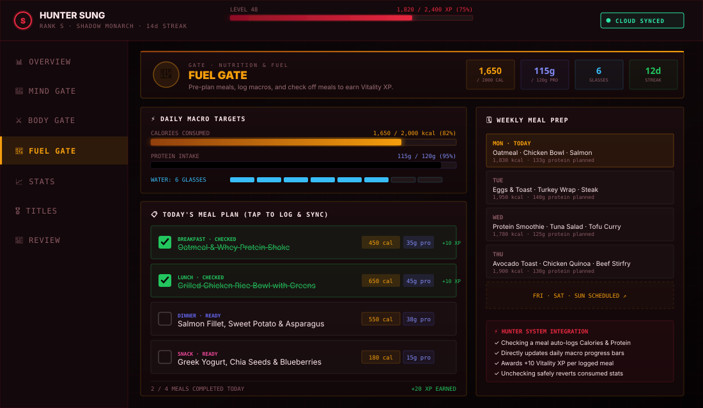
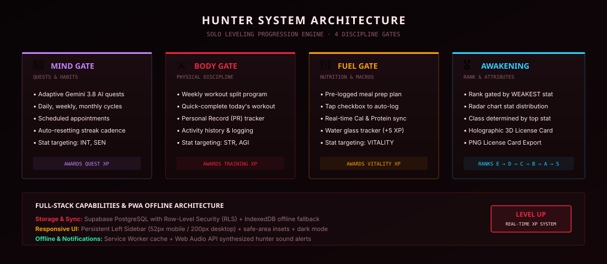

# ⚔️ Hunter System — Personal Progression & Habit Engine

> *"Arise."* A high-performance, *Solo Leveling*-inspired personal progression tracker, task engine, workout companion, and nutrition planner designed to gamify real-life discipline.



---

## ⚡ System Overview

The **Hunter System** bridges RPG mechanics with measurable daily habits. Every quest you complete, workout you execute, and meal you fuel your body with awards **XP** and pushes your hunter attributes forward. 

Unlike traditional trackers, rank is not simply purchasable by grinding easy tasks: **Rank progression is gated by both your overall Level AND your weakest stat.** A true Hunter must remain well-rounded across Mind, Body, and Nutrition.



---

## 🗝️ Core Features & Gates

### 1. 📱 Responsive Left Sidebar Navigation
* **Universal Layout:** The primary selection bar is pinned to the **left sidebar** across all screen sizes.
* **Compact on Mobile:** Adapts to a 52px icon bar with vertical micro-labels, respecting dynamic islands and device safe-area insets.
* **Expanded on Desktop:** Expands to 200px width with horizontal indicators and active-tab glowing borders.
* **Independent Scrolling:** Content scrolls freely within independent viewport panes without layout shifting.

---

### 2. 🍴 Fuel Gate (Nutrition & Meal Prep Tracker)
The newly introduced **Fuel Gate** integrates daily nutrition directly into your hunter's **Vitality** progression:

* **Interactive Checkbox Meal Logging:**
  * Pre-planned meals appear in **Today's Meal Plan** as quick-tap checklist items.
  * Tapping a checkbox automatically logs the meal with its exact pre-logged **Calories** and **Protein**, striking out the meal and awarding **+10 Vitality XP**.
  * Tapping again unchecks the meal and safely reverts the consumed macros.
* **Pre-Logged Weekly Meal Prep Plan:**
  * Interactive **Monday–Sunday** meal prep planner.
  * For every day, enter custom meal names along with target **Calories** and **Protein (g)** for **Breakfast ☕, Lunch ☀️, Dinner 🌙, and Snacks 🍪**.
* **Daily Macro & Hydration Targets:**
  * Live-updating animated progress bars for **Calories** and **Protein** that shift to neon green upon meeting target thresholds.
  * Fully customizable daily target limits.
  * 8-glass water hydration gauge with `+` / `−` quick increments (+5 XP on your first glass each day).
* **7-Day Macro Ring History:**
  * Circular SVG progress rings showing daily meal counts, calories, and water intake at a glance.
  * Historical date navigation (`←` / `→`) to inspect and edit logs from previous days.
* **Favorites System (★):**
  * Bookmark your go-to meals to re-log them with one tap at any time.

---

### 3. 🧠 Mind Gate (Quests & Habits)
* **Adaptive AI Hunter Intelligence:** Powered by **Google Gemini 3.8 Flash**, analyzing your current stats, history, and goals to generate tailored quests.
* **Multi-Cadence Quests:**
  * **Daily Quests:** High-discipline daily habits with automatic midnight reset.
  * **Weekly / Monthly / Quarterly / Yearly:** Compound challenges with cadence-aware rollover and streak tracking.
  * **Scheduled Appointments:** Fixed calendar-date commitments.
* **Streak Multiplier:** Consecutive completions build streaks that boost rank qualifications.

---

### 4. 🏋️ Body Gate (Physical Discipline & Workouts)
* **Weekly Split Program:** Built-in split scheduler (Chest, Back, Legs, Shoulders, Arms, Rest) synchronized to the calendar day.
* **Workout Logging:** Record custom exercises, sets, weights, and reps.
* **Personal Records (PRs):** Log and track your all-time heaviest lifts and milestones.
* **Stat Allocation:** Training sessions actively build **Strength (STR)** and **Agility (AGI)**.

---

### 5. 🎖️ Awakening (Stats & Holographic License)
* **Radar Chart Stat Distribution:** Visualizes your 5 core attributes:
  * **STR** (Strength)
  * **VIT** (Vitality)
  * **AGI** (Agility)
  * **INT** (Intelligence)
  * **SEN** (Sense)
* **Archetype / Class Determination:** Automatically derives your Hunter Class (*Warrior, Guardian, Assassin, Mage, Tracker*) based on your highest trained stat.
* **3D Holographic Hunter License Card:**
  * Interactive 3D tilt and holographic shine with mouse/touch movement.
  * Custom photo/avatar upload and rank watermark.
  * One-click **Download as PNG** card export powered by `html2canvas`.
* **Ranks:** Progress from **Rank E → D → C → B → A → Rank S Monarch**.

---

### 6. 📜 Weekly AI Review
* Generates an honest, unbiased performance breakdown powered by LLM edge analysis:
  * **Verdict:** System evaluation of your discipline.
  * **What Held:** Solid habits and completed quotas.
  * **What Slipped:** Missed workouts or abandoned quests.
  * **The One Change:** Single highest-leverage improvement for the upcoming week.

---

## 🛠️ Tech Stack & Architecture

| Layer | Technology |
|---|---|
| **Frontend** | React 18, Vite, Tailwind CSS, Lucide Icons |
| **Data Visualization** | Recharts (Responsive AreaChart & RadarChart) |
| **Persistence** | Supabase PostgreSQL with Row-Level Security (RLS) + LocalStorage Vault |
| **PWA & Offline** | Vite PWA Plugin, Custom Service Worker, IndexedDB caching |
| **Audio Engine** | Web Audio API (Synthesized 3-tone Hunter alert chimes) |
| **AI Integration** | Google Gemini API (Gemini 3.8 Flash) |

---

## 🚀 Getting Started

### 1. Prerequisites
- Node.js 18+ installed
- Free [Supabase](https://supabase.com) project (for cloud sync & auth)

### 2. Environment Setup
Clone the repository and install dependencies:
```bash
git clone https://github.com/Parthiv307/sysyem.git
cd sysyem
npm install
```

Configure environment variables in `.env.local`:
```bash
cp .env.local.example .env.local
```
Add your Supabase credentials:
```env
VITE_SUPABASE_URL=https://your-project.supabase.co
VITE_SUPABASE_ANON_KEY=your-anon-public-key
```

### 3. Initialize Supabase Database
In your Supabase project's **SQL Editor**, paste and run the contents of `supabase/schema.sql`. This provisions the `hunter_data` table with row-level security so accounts remain completely isolated.

### 4. Run Development Server
```bash
npm run dev
```
Open **http://localhost:5173** to launch the Hunter System.

---

## 📦 Production Build & Deployment

Build optimized static assets and PWA service workers:
```bash
npm run build
```

Deployable with zero configuration to **Vercel**, **Netlify**, or **Cloudflare Pages**:
* **Build Command:** `npm run build`
* **Output Directory:** `dist`
* **Environment Variables:** `VITE_SUPABASE_URL`, `VITE_SUPABASE_ANON_KEY`

---

## 📜 License
MIT License. Inspired by Chugong's *Solo Leveling*. Built for personal peak performance.
